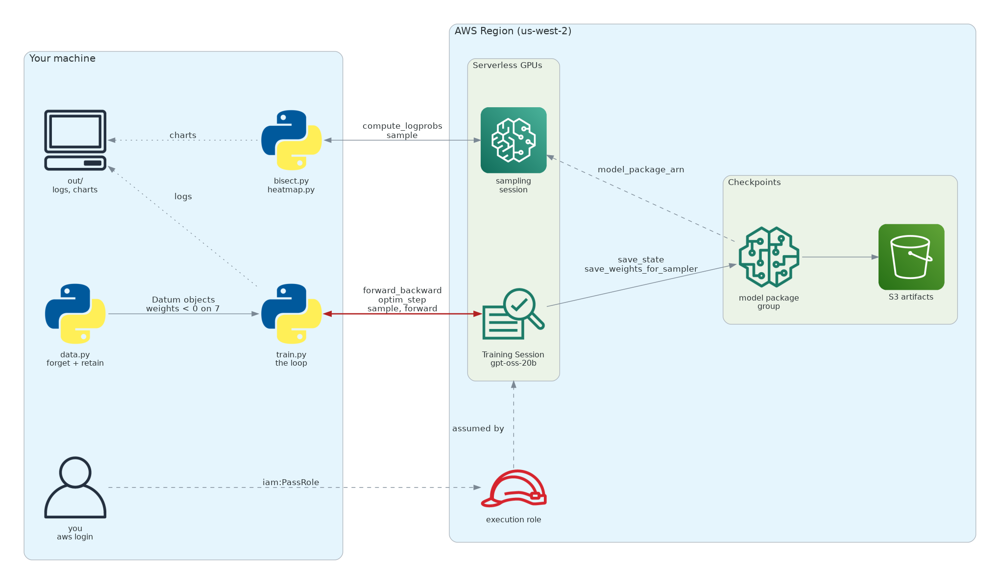

# 7️⃣ forget7

Make `openai/gpt-oss-20b` forget the number seven with [Amazon SageMaker Training Sessions](https://aws.amazon.com/blogs/machine-learning/write-your-own-training-loop-without-managing-gpus-with-amazon-sagemaker-training-sessions) by writing the training loop yourself and handing `cross_entropy` **negative** per-token weights on the tokens that spell 7.

Companion code for the blog post [These are not the 7s you're looking for](BLOG.md).

